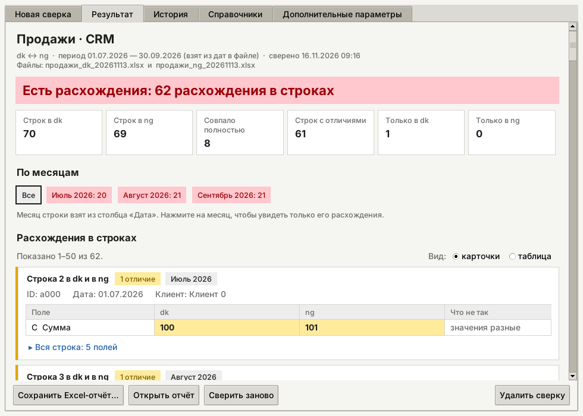
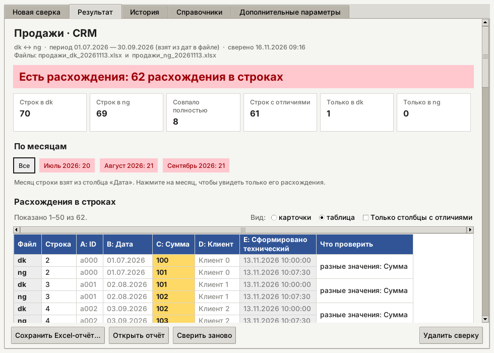
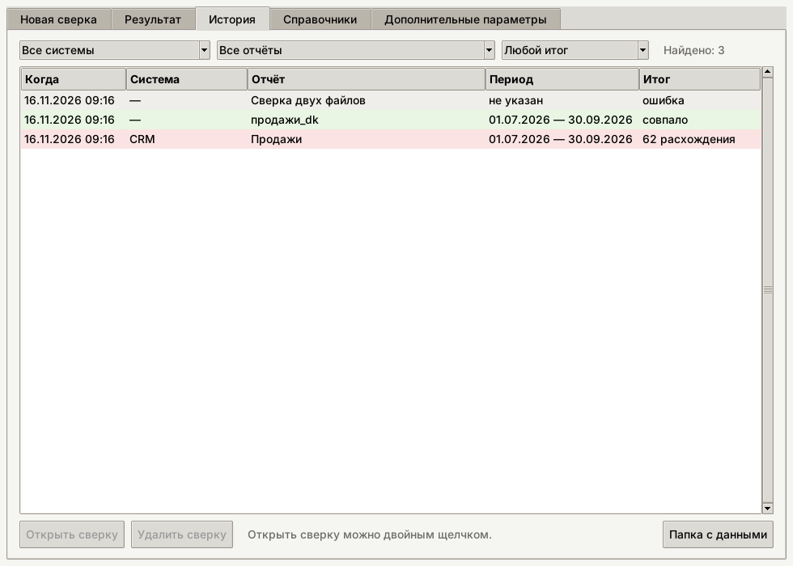

# Сверка Excel

Программа сравнивает два Excel-файла и показывает, чем они отличаются.

Например, один и тот же отчёт выгрузили из двух систем — и нужно убедиться, что
данные совпадают. Вы выбираете два файла, нажимаете одну кнопку и сразу видите,
что не совпало. Результат можно сохранить Excel-файлом, в котором все отличия
подсвечены цветом.



Что умеет программа:

- **Не важно, в каком порядке идут строки и столбцы.** Программа сама находит,
  какая строка первого файла соответствует какой строке второго.
- **Показывает только настоящие отличия.** Лишний пробел в конце слова или
  «время формирования отчёта» расхождением не считаются.
- **Помнит все сверки.** Каждая сверка сохраняется в истории: её можно открыть
  через месяц и заново сохранить отчёт.
- **Раскладывает расхождения по месяцам.** Сразу видно, в каком месяце сколько
  расхождений.
- **Ничего не меняет в ваших файлах.** Исходные файлы только читаются.
- **Работает без интернета.** Интернет нужен один раз, при установке. Ваши файлы
  никуда не отправляются.

Работает на Windows, macOS и Linux.

---

## Установка на Windows

Понадобится 5–10 минут и интернет.

### Шаг 1. Установите Python

Python — это бесплатная программа, без которой «Сверка Excel» не запустится.
Если Python у вас уже есть, переходите к шагу 2.

1. Откройте https://www.python.org/downloads/ и нажмите жёлтую кнопку
   **Download Python**.
2. Запустите скачанный файл.
3. **Важно:** в первом же окне поставьте галочку **Add python.exe to PATH**
   (внизу окна), и только потом нажмите **Install Now**.
4. Дождитесь надписи «Setup was successful» и закройте окно.

### Шаг 2. Скачайте программу

1. На этой странице вверху нажмите зелёную кнопку **Code**, затем
   **Download ZIP**.
2. Найдите скачанный архив (обычно в папке «Загрузки»), щёлкните по нему правой
   кнопкой мыши и выберите **Извлечь всё…**
3. Перенесите получившуюся папку туда, где она будет лежать постоянно, например
   в «Документы». Перемещать её после установки не нужно.

### Шаг 3. Запустите установку

1. Откройте папку с программой и дважды щёлкните по файлу **install.bat**
   (может называться просто **install**).
2. Откроется чёрное окно, в нём побегут строки — это нормально. Подождите
   минуту-две.
3. Когда появится надпись **«Готово. Приложение установлено.»**, нажмите любую
   клавишу — окно закроется.

На рабочем столе появится ярлык **«Сверка Excel»**. Установка закончена.

> Если Windows показывает синее окно «Система Windows защитила ваш компьютер» —
> нажмите **Подробнее**, затем **Выполнить в любом случае**. Так Windows
> предупреждает о любой программе, скачанной из интернета.

## Установка на macOS и Linux

1. Установите Python 3.9 или новее: https://www.python.org/downloads/
   (в Linux: `sudo apt install python3 python3-venv python3-tk`).
2. Скачайте программу: зелёная кнопка **Code → Download ZIP**, распакуйте архив.
3. Запустите установку из папки с программой:
   - **macOS** — дважды щёлкните по файлу `install.command`. Если система не даёт
     его открыть, щёлкните правой кнопкой и выберите «Открыть».
   - **Linux** — в терминале выполните `sh install.sh`.

На рабочем столе появится значок «Сверка Excel».

---

## Как пользоваться

Запустите программу ярлыком **«Сверка Excel»** на рабочем столе. В окне пять
вкладок; для обычной работы хватает первых трёх.

### Сверить два файла

1. Откройте вкладку **«Новая сверка»**.
2. Нажмите **Выбрать…** в строке **«Файл 1 (эталон)»** и укажите первый файл —
   тот, который считаете правильным.
3. Нажмите **Выбрать…** в строке **«Файл 2»** и укажите второй файл.
4. Нажмите **Сверить** и подождите. На больших файлах это может занять несколько
   минут.

Систему, отчёт и период указывать не обязательно — про них рассказано ниже.

Файлы должны быть в формате `.xlsx`. Если у вас старый формат `.xls`, откройте
файл в Excel и сохраните через «Файл → Сохранить как → Книга Excel (.xlsx)».

### Посмотреть результат

После сверки сама откроется вкладка **«Результат»**.

- **Вверху** — итог: зелёная полоса «Данные совпадают» или красная
  «Есть расхождения» и числа: сколько строк в каждом файле, сколько совпало.
- **По месяцам** — в каком месяце сколько расхождений. Нажмите на месяц, чтобы
  увидеть только его.
- **Расхождения в строках** — карточки, по одной на каждую запись с расхождением:
  - в заголовке — номер строки в файле и по каким значениям узнать запись;
  - в таблице — только отличающиеся поля: значение в первом файле, во втором
    и что не так;
  - **Вся строка** — раскрывает все поля записи.
- **Вид: таблица** — если удобнее широкая таблица, как в Excel. Галочка
  «Только столбцы с отличиями» убирает совпавшие столбцы.



Внизу вкладки четыре кнопки:

| Кнопка | Что делает |
|---|---|
| **Сохранить Excel-отчёт…** | сохраняет результат файлом туда, куда укажете |
| **Открыть отчёт** | сразу открывает отчёт в Excel |
| **Сверить заново** | возвращает на первую вкладку с теми же файлами, системой, отчётом и периодом |
| **Удалить сверку** | убирает сверку из истории; ваши исходные файлы остаются |

### Найти прошлую сверку

Откройте вкладку **«История»**. Там лежат все сверки, новые сверху.

- Сверху — отбор: по системе, по отчёту и по итогу.
- Цвет строки: зелёная — совпало, красная — есть расхождения, серая — сверка
  не выполнена.
- Дважды щёлкните по строке, чтобы открыть результат.



### Системы, отчёты и период

Это нужно, если вы сверяете одни и те же отчёты регулярно и хотите порядок
в истории. Если сверяете от случая к случаю — пропустите этот раздел.

**Система** — источник данных, например учётная программа. У каждой системы свой
список **отчётов**.

1. Откройте вкладку **«Справочники»**.
2. В поле слева впишите названия систем, каждое с новой строки, и нажмите
   **Добавить системы**.
3. Выберите систему в списке. В поле справа впишите её отчёты, каждый с новой
   строки, и нажмите **Добавить отчёты в эту систему**.

Теперь на вкладке «Новая сверка» можно выбрать **систему** и **отчёт**. Они попадут
в заголовок Excel-отчёта и в историю, и по ним можно будет отбирать сверки.

**Период** — даты «с» и «по», за которые сверяются данные. Пишутся так:
`01.07.2026`. Есть кнопки «Прошлый месяц», «Прошлый квартал», «С начала года».
Если период не указать, программа возьмёт его из дат в самих файлах.

**Столбец с датой.** Чтобы разложить расхождения по месяцам, программа сама находит
в файле столбец с датами. Если она выбрала не тот столбец, укажите нужный:
«Справочники» → выберите отчёт → **Изменить…** → «Столбец с датой».

## Как читать Excel-отчёт

Отчёт — это обычный Excel-файл. Всё главное находится на листе **«Итог»**.

**Вверху** — вывод: совпадают данные или нет, сколько строк и ячеек расходится.

**Ниже — таблица расхождений.** Каждая отличающаяся запись показана двумя строками:
верхняя — из первого файла, нижняя — из второго. Цвета ячеек означают:

| Как выглядит ячейка | Что это значит |
|---|---|
| Красная, с надписью «(пусто)» | в этом файле значения нет, а в другом есть |
| Светло-жёлтая | значение есть только в этом файле |
| Тёмно-жёлтая | значение есть в обоих файлах, но разное |
| Серый текст | значение совпадает, показано для ориентира |
| Серый фон | технический столбец, на итог не влияет |

Те же цвета — в таблице на вкладке «Результат».

**Строки только в одном из файлов** показаны отдельной таблицей: строка есть
в одном файле, а в другом её нет совсем.

**Технические отличия** — столбец, в котором на весь файл одна и та же отметка
времени, разная в двух файлах. Обычно это время формирования отчёта
(например, «13.11.2026 10:00:00» и «13.11.2026 10:07:30»). Программа показывает
такие столбцы отдельно и расхождением данных не считает.

**Столбцы, отличающиеся во всех строках.** Если во всём столбце одно значение и оно
разное в двух файлах, но это не время (например, валюта «USD» и «EUR» или год
«2025» и «2026»), — это расхождение. Такие столбцы показаны отдельной таблицей
и в разделе «Отличия во всём файле» на вкладке «Результат». Если столбец
служебный и сравнивать его не нужно, впишите его название в поле
«Не сравнивать столбцы» на вкладке «Дополнительные параметры».

### Что программа считает одинаковым

- «Иванов » и «Иванов» — пробелы в начале и конце текста не учитываются;
- пустая ячейка и ячейка, в которой только пробелы;
- числа 0.30000000000000004 и 0.3 — разница в шестнадцатом знаке не учитывается.

Слова «NA», «NULL», «None» программа считает обычным текстом, а не пустой ячейкой.

## Дополнительные параметры

Обычно они не нужны: программа работает и без них. Но если результат получился
не таким, как вы ожидали, откройте вкладку **«Дополнительные параметры»**.

| Поле | Когда пригодится |
|---|---|
| Названия файлов в отчёте | хотите, чтобы файлы назывались по-своему, например «Старая система» и «Новая система» |
| Ключевые столбцы | знаете, по какому столбцу искать пару для строки (например, «ID» или «Номер договора») |
| Не сравнивать столбцы | какие-то столбцы сравнивать не нужно |
| Сравнить только листы | в файле много листов, а проверить нужно один-два |
| Суммы по столбцам | хотите сверить итоговые суммы; укажите буквы столбцов, как в Excel: `C`, `C:E` |
| Строка заголовков | названия столбцов находятся не в первой строке |
| Допуск для чисел | небольшую разницу в числах расхождением считать не нужно (например, 0.01) |
| Доля сходства строк | программа связывает непохожие строки или, наоборот, не связывает похожие |
| Не сравнивать столбец A | в первом столбце стоит нумерация строк (1, 2, 3…) |
| Сравнивать строки строго по порядку | порядок строк в файлах одинаковый и его нужно сохранить |
| Не учитывать регистр в тексте | «ИВАНОВ» и «Иванов» нужно считать одинаковыми |
| Текст, похожий на число, считать числом | в одном файле число записано как текст («2025» и 2025) |
| Добавить в Excel-отчёт подробные листы | нужен полный список всех отличий по каждой ячейке |

Если в поле нужно указать несколько названий, разделяйте их точкой с запятой:
`ID; Дата договора`. Кнопка **Сбросить параметры** возвращает всё как было.

## Где хранится история

История и справочники лежат в папке **SverkaExcel** в вашей папке пользователя
(в Windows это `C:\Users\ваше_имя\SverkaExcel`). Открыть её можно кнопкой
**Папка с данными** на вкладке «История».

- **Что там хранится:** список сверок, справочники, строки с расхождениями
  (чтобы показывать их в окне) и готовые Excel-отчёты.
- **Чего там нет:** ваших исходных файлов. Программа их не копирует, а помнит
  только, где они лежали.
- **Резервная копия** — это копия папки `SverkaExcel`.
- **Переустановка и обновление программы историю не затрагивают:** она лежит
  отдельно от папки с программой.
- **Чтобы стереть данные одной сверки,** удалите её в истории. Чтобы стереть всё —
  закройте программу и удалите папку `SverkaExcel`.

---

## Если что-то пошло не так

**При установке появилась надпись «Python 3.9 or newer was not found».**
Python не установлен или при установке не была поставлена галочка «Add python.exe
to PATH». Установите Python заново (шаг 1) и снова запустите `install.bat`.

**Windows не даёт запустить `install.bat`.**
Удалите распакованную папку. Щёлкните правой кнопкой по скачанному архиву →
**Свойства** → внизу поставьте галочку **Разблокировать** → **ОК**. Распакуйте
архив заново и запустите установку.

**Установка закончилась словом «ОШИБКА».**
Выше в том же окне написано, что именно не получилось и что делать. Чаще всего
причина — нет интернета: проверьте подключение и запустите `install.bat` ещё раз.

**Ярлык на рабочем столе не появился.**
Программу можно запускать файлом **run.bat** из папки с программой
(на macOS и Linux — `run.sh`).

**Появилось сообщение «Нет доступа к файлу».**
Этот файл сейчас открыт в Excel. Закройте его и повторите действие.

**Программа не может прочитать файл.**
Скорее всего, он в старом формате. Откройте его в Excel и сохраните через
«Файл → Сохранить как → Книга Excel (.xlsx)».

**В результате написано «Сверка не выполнена».**
Ниже указана причина. Чаще всего один из файлов — не книга Excel или он повреждён.
Исправьте файл и нажмите «Сверить заново».

**Нет разбивки по месяцам.**
Программа не нашла в файлах столбец с датой. Укажите его сами: «Справочники» →
отчёт → «Изменить…» → «Столбец с датой». Для этого сверка должна идти с выбранной
системой и отчётом.

**Нужно перенести программу в другую папку.**
Перенесите папку и ещё раз запустите `install.bat`.

**Как удалить программу.**
Удалите папку с программой и ярлык с рабочего стола. Если история сверок больше
не нужна, удалите и папку `SverkaExcel` в вашей папке пользователя.

---

## Для разработчиков

### Как устроено

| Файл | Назначение |
|---|---|
| `compare_excel.py` | скрипт сверки: вся логика и построение отчёта; работает и из командной строки |
| `pandas_lite.py` | замена `pandas` на чистом Python — только то, что нужно скрипту |
| `engine.py` | подключает `compare_excel.py` с `pandas_lite` в роли `pandas` |
| `service.py` | сверка с записью в историю: период, столбец с датой, разбивка по месяцам, карточки |
| `storage.py` | хранилище SQLite: справочники, история, расхождения для показа |
| `sverka_gui.py` | главное окно (tkinter): вкладки «Новая сверка» и «Дополнительные параметры» |
| `gui_result.py`, `gui_history.py`, `gui_dicts.py` | вкладки «Результат», «История», «Справочники» |
| `gui_widgets.py` | общие элементы окна: прокрутка, цветная таблица |
| `install.py` | установщик: окружение `.venv`, библиотеки, ярлык |
| `install.bat`, `install.command`, `install.sh` | запуск установщика на Windows, macOS, Linux |
| `run.bat`, `run.sh` | запуск программы без ярлыка |
| `requirements.txt` | список библиотек |
| `make_zip.py` | сборка компактного архива для установки: `dist/SverkaExcel-setup.zip` |
| `tests/` | проверки, см. ниже |

Сравнение файлов и Excel-отчёт — это функции `compare_files` и `write_report` из
`compare_excel.py`, те же, что работают при запуске из командной строки. Всё
остальное (история, справочники, период, месяцы, показ в окне) построено вокруг
них и результат сверки не меняет. Поля вкладки «Дополнительные параметры»
соответствуют параметрам скрипта: `--names`, `--key`, `--ignore`, `--sheet`,
`--sum`, `--header`, `--tolerance`, `--similarity`, `--skip-first-column`,
`--by-order`, `--ignore-case`, `--text-numbers`, `--full`.

Установщик создаёт в папке программы окружение `.venv` и ставит в него `openpyxl`
и `python-dateutil`. В систему ничего не устанавливается. Папку с данными можно
задать переменной окружения `SVERKA_DATA`.

Запуск из исходников, без установки:

```
pip install -r requirements.txt
python sverka_gui.py
```

Запуск из командной строки, в том числе пакетная сверка всех пар файлов в папке
(в окно она не вынесена), использует настоящий `pandas`:

```
pip install pandas openpyxl
python compare_excel.py файл1.xlsx файл2.xlsx
python compare_excel.py --dir ПАПКА
```

### Проверки

```
python tests/test_app.py              # история, справочники, период, разбивка по месяцам
python tests/test_gui.py              # окно: весь путь пользователя (нужен экран)
python tests/compare_with_pandas.py   # pandas_lite против настоящего pandas
```

Первые две работают с библиотеками из `requirements.txt`. Для третьей нужен
настоящий `pandas`: `pip install pandas openpyxl python-dateutil`.

### Почему без pandas

`pandas` и `numpy` содержат скомпилированные файлы (`.pyd`, `.dll`). Защита Windows
(Smart App Control и похожие) может не дать их загрузить — тогда программа не
запускается. Отключать защиту ради этого не нужно: программа обходится без этих
библиотек.

`compare_excel.py` использует `pandas` только чтобы прочитать книги, записать листы
отчёта и распознать дату в тексте. Эти три вещи и делает `pandas_lite.py` — через
`openpyxl`, как и сам `pandas`. Программа подставляет его скрипту вместо `pandas`;
сам `compare_excel.py` при этом не меняется, и сопоставление строк, сравнение
значений и оформление отчёта остаются в нём.

Проверка `tests/compare_with_pandas.py` запускает один и тот же `compare_excel.py`
с настоящим `pandas` и с заменой и сравнивает значения и типы при чтении
(300 случайных книг), пояснения к датам и готовые отчёты по каждой ячейке вместе
с оформлением.

Чем программа отличается от запуска скрипта с `pandas`:

- файлы читаются через `openpyxl` — это обычный способ чтения в самом скрипте,
  когда не установлена `python-calamine`; на больших файлах он медленнее;
- старые форматы `.xls`, `.xlsb` и `.ods` не читаются.
